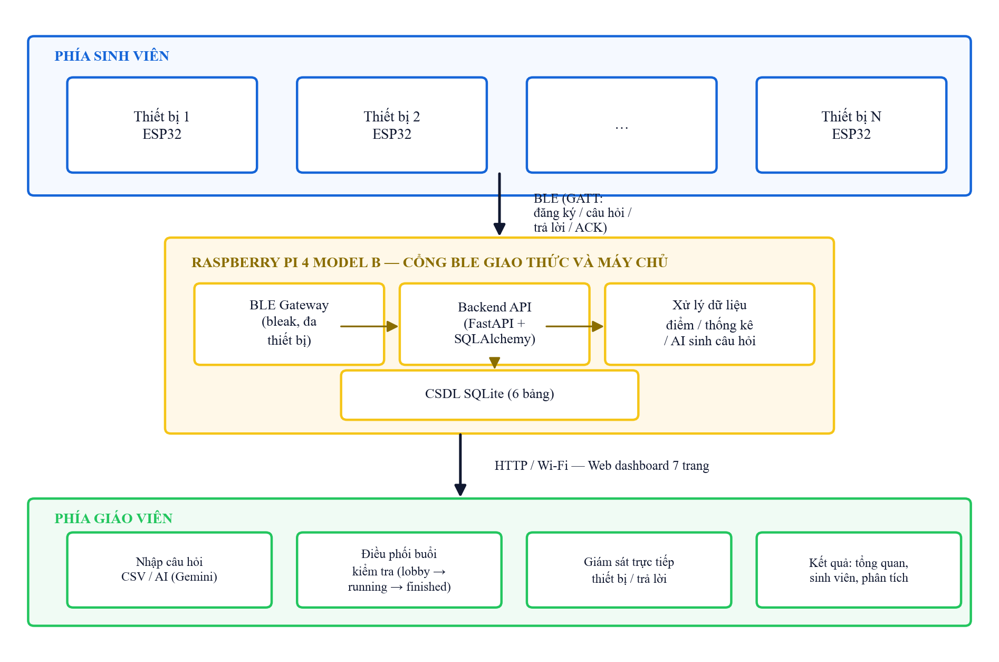
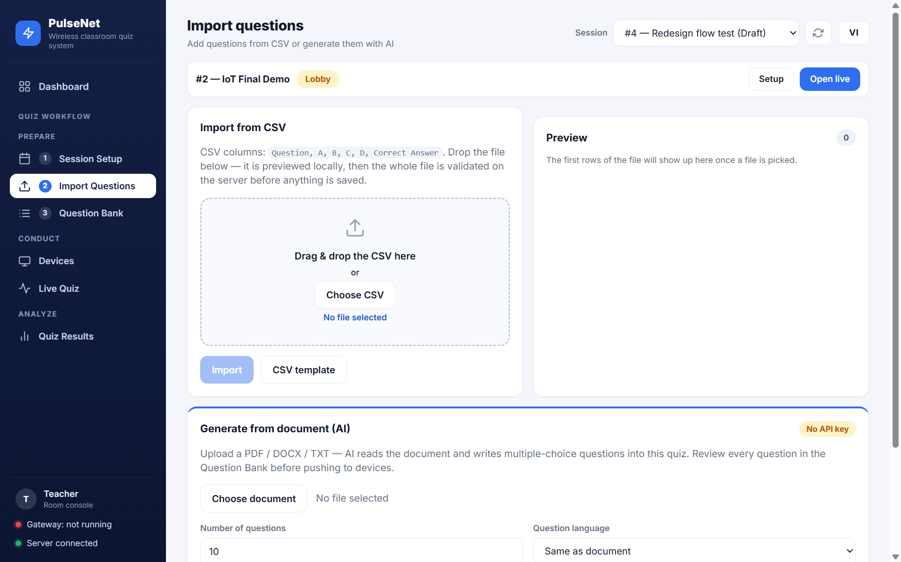
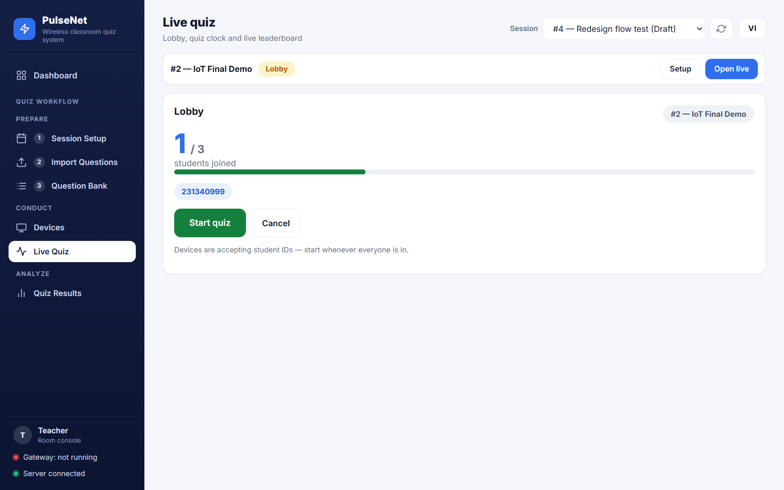
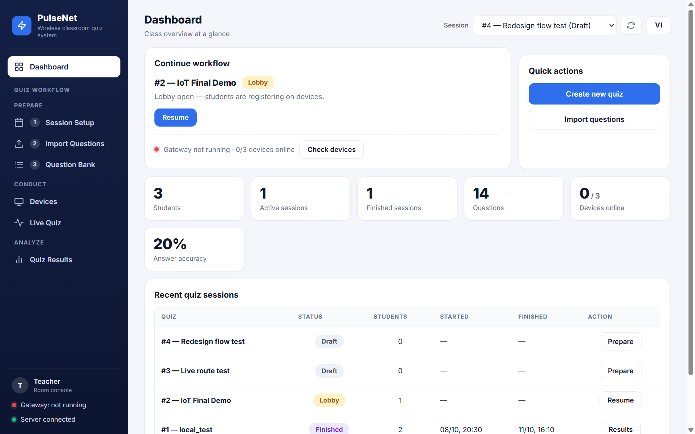
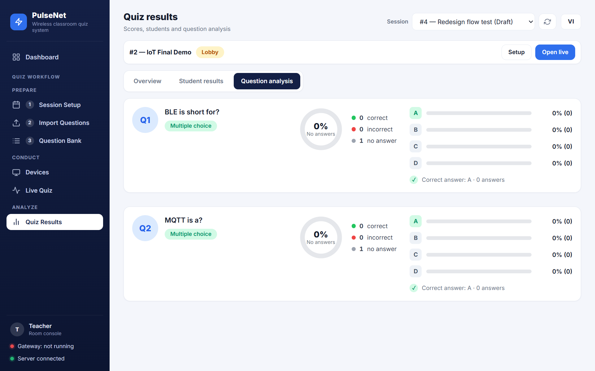
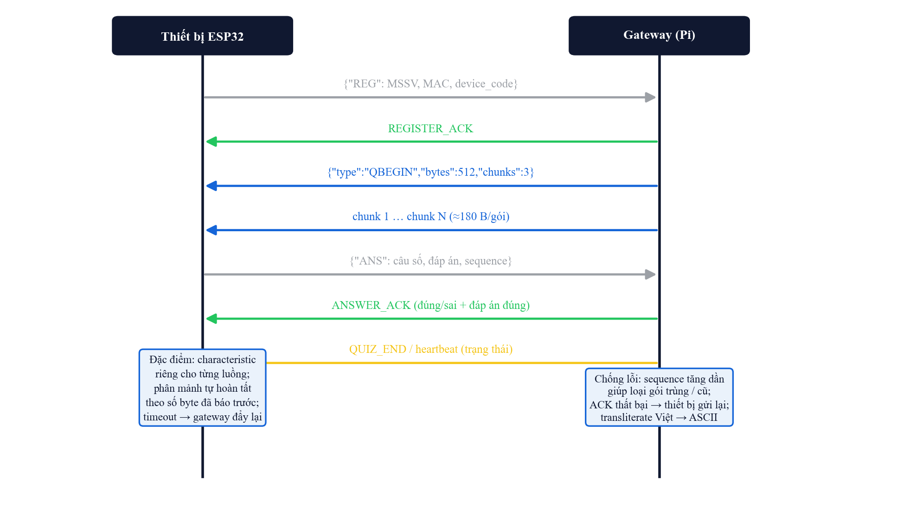
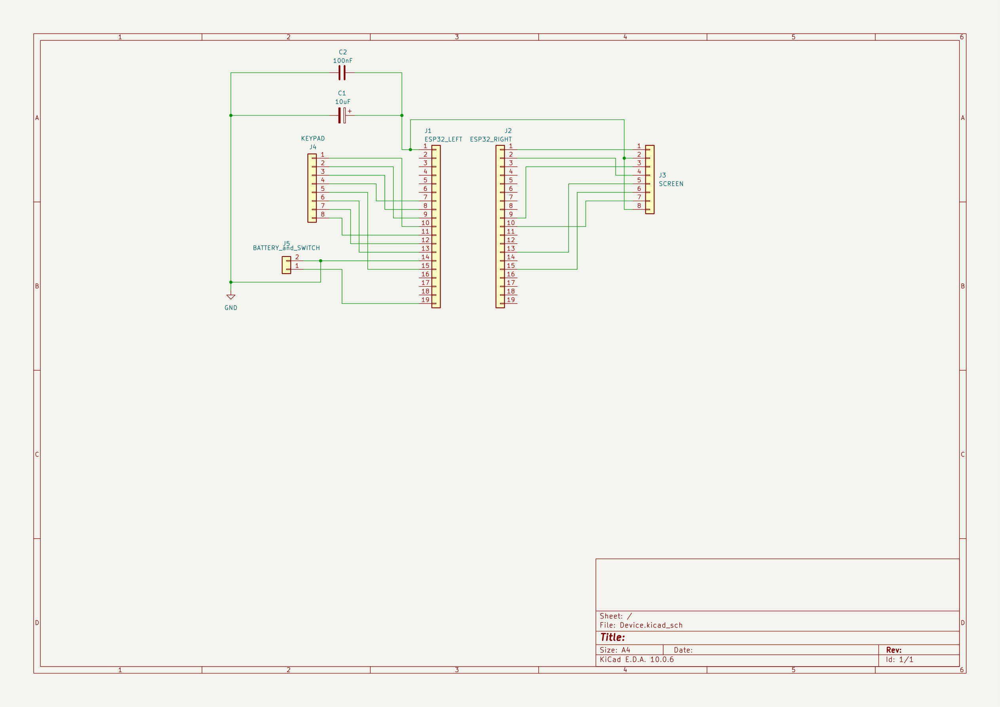
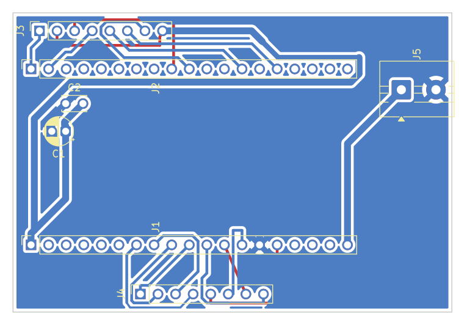
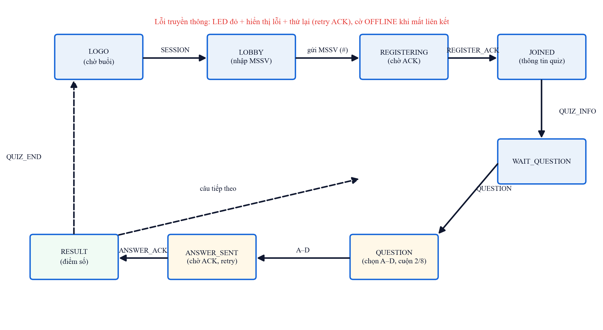
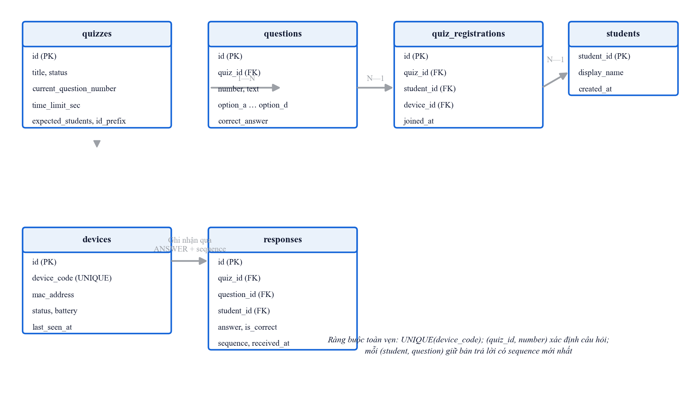

<div align="center">


# PulseNet

**Smart Wireless Quiz & Assessment System**

ESP32 clickers · BLE · Raspberry Pi gateway · FastAPI dashboard with live analytics

[](https://github.com/KateLu16/PulseNet/actions/workflows/ci.yml)
[](LICENSE)
[](https://platformio.org/)
[](https://fastapi.tiangolo.com/)
[](https://www.kicad.org/)

*An end-to-end IoT course project — Ho Chi Minh City University of Technology and Education (HCMUTE)*

</div>

---

## What is PulseNet?

PulseNet turns any classroom into an interactive one. Every student gets a
battery-powered **wireless response device**: they type their student ID on a
4×4 keypad, receive each question on a 1.8″ TFT display over BLE, and answer
with a single key press. A **Raspberry Pi** acts as the BLE gateway and local
server, running the database, REST API and the **teacher dashboard** — a web
app for importing questions, running live sessions and analyzing results in
real time.

The whole chain — custom PCB, 3D-printed enclosure, firmware, gateway,
backend, dashboard and analytics — was designed and built from scratch.

<p align="center">
  
</p>

## Highlights

- **Full wireless classroom flow** — student registration (ID ↔ device MAC
  mapping), question delivery, A–D answering and acknowledgement, all over BLE
  with sequence numbers for duplicate/stale-packet protection.
- **Teacher dashboard** — 7 views: Dashboard, Question Bank, Import, Sessions,
  Devices, Live and Results, following a *Prepare → Conduct → Analyze* workflow.
- **Live monitoring** — per-question answer distribution, submitted/missing
  students and device online/offline status via gateway heartbeats, updated
  while the quiz is running.
- **Rich analytics** — student scores, correct/wrong/blank breakdown,
  per-question accuracy and full-class statistics after every session.
- **AI quiz generation** — upload a PDF (lecture notes, slides…) and Gemini
  generates a complete multiple-choice question set, with model fallback and
  retry on rate limits. Works fully offline without an API key.
- **CSV question import** — validated template upload with per-row error
  reporting, plus append/conflict handling for existing question banks.
- **Self-paced & presenter-led modes** — students may answer questions in any
  order (self-paced) or follow the teacher's current question; the backend
  owns quiz deadlines even if the gateway goes offline.
- **Custom hardware** — 2-layer KiCad PCB (ESP32-WROOM-32, ST7735 TFT, 4×4
  keypad, RGB status LED, CR2032 coin cell) in a 3D-printed enclosure.

## Screenshots

| Prepare — import questions (CSV or AI-generated from PDF) | Conduct — live session |
|---|---|
|  |  |

| Dashboard home | Analyze — results & statistics |
|---|---|
|  |  |

## System architecture

```
Student Device (×N)          Raspberry Pi 4B                    Teacher
┌──────────────────┐   BLE  ┌──────────────────────┐   Wi-Fi  ┌───────────────┐
│ ESP32-WROOM-32   │        │ BLE gateway (bleak)  │          │ Tablet / PC   │
│ 4×4 keypad       ├───────►│  FastAPI backend     ├─────────►│ Browser       │
│ 1.8" TFT ST7735  │        │  SQLite (SQLAlchemy) │  :8000   │ Dashboard     │
│ RGB LED · CR2032 │◄───────┤  Analytics engine    │          │               │
└──────────────────┘  Q/ACK └──────────────────────┘          └───────────────┘
```

**BLE protocol** — the device exposes Nordic-UART-style GATT characteristics
for *registration*, *question*, *answer* and *ACK*. Every answer carries a
monotonic sequence number; the backend accepts only the newest answer per
(student, question) pair and detects duplicate delivery.

<p align="center">
  
</p>

## Hardware

### Student device

| Subsystem | Part |
|---|---|
| MCU / radio | ESP32-WROOM-32 (Bluetooth Low Energy) |
| Display | 1.8″ TFT LCD, ST7735 driver, 160×128 |
| Input | 4×4 matrix keypad (0–9 student ID, A–D answer, `*` clear, `#` confirm) |
| Feedback | RGB status LED (idle / connecting / accepted / error) |
| Power | CR2032 coin cell + slide switch |
| Boards | Custom 2-layer PCB, 63.4 × 43.2 mm |
| Enclosure | 3D-printed housing (SolidWorks design + STEP models) |

| Schematic (KiCad) | PCB layout |
|---|---|
|  |  |

### Firmware

- Built with **PlatformIO** (Arduino framework), **NimBLE-Arduino** for the
  BLE GATT server and **Adafruit GFX + ST7735** drivers.
- A compact state machine handles the full student journey — including a
  paginated document renderer so long questions scroll cleanly on the small
  TFT, and a boot splash with the university logo.

<p align="center">
  
</p>

## Server

- **Backend** — Python FastAPI + SQLAlchemy over SQLite, served by uvicorn on
  port 8000. REST endpoints for quizzes, questions, devices, responses,
  monitoring and analytics.
- **BLE gateway** — Python service using [bleak](https://github.com/hbldh/bleak)
  to connect student devices, forward registrations/answers to the API and
  push questions/ACKs back out.
- **Dashboard** — dependency-free static web app (`HTML/CSS/JS`) served by the
  backend, designed for tablet browsers.
- **Database schema:**

<p align="center">
  
</p>

## Repository layout

```
PulseNet/
├── PulseNet-device/     # ESP32 firmware (PlatformIO, NimBLE, Arduino)
├── PulseNet-server/     # Raspberry Pi server
│   ├── backend/         #   FastAPI app, dashboard (web/), tests, .env.example
│   └── gateway/         #   BLE gateway (bleak) + debug tools
├── Device/              # KiCad hardware project (schema + 2-layer PCB)
├── 3D_DESIGN/           # Enclosure CAD (SolidWorks + STEP)
├── docs/img/            # Figures used by this README
└── .github/workflows/   # CI: backend tests + firmware build
```

## Quick start

### 1. Server (Raspberry Pi or any Linux/macOS box)

```bash
cd PulseNet-server
git clone https://github.com/KateLu16/PulseNet.git   # or copy the folder to the Pi
cd PulseNet/PulseNet-server/backend

python -m venv .venv
source .venv/bin/activate          # Windows: .venv\Scripts\activate
pip install -r requirements.txt

# Optional — enable AI quiz generation (https://aistudio.google.com/apikey)
cp .env.example .env               # then edit GEMINI_API_KEY=...

python -m uvicorn app.main:app --host 0.0.0.0 --port 8000
```

Open `http://<server-ip>:8000/` in a browser — that's the teacher dashboard.
The BLE gateway additionally needs `pip install bleak`; on the Pi the
ready-made scripts in `PulseNet-server/` (`start_server.sh`, `start_gateway.sh`,
`status_all.sh`, `stop_all.sh`) manage both services.

### 2. Student device firmware

```bash
pip install platformio
pio run -d PulseNet-device -t upload    # build + flash over USB
pio device monitor -d PulseNet-device   # 115200 baud serial monitor
```

On first boot the device shows a splash screen, then waits for the student ID.

## Testing

The backend ships with a hardware-free integration suite that simulates a
full classroom session — three devices, self-paced answers, duplicate/stale
packets, re-answers, deadlines and result aggregation — against a throwaway
database:

```bash
cd PulseNet-server/backend
python test_integration_e2e.py
```

This is the same suite that runs in CI on every push.

## Roadmap

- [ ] RGB LED status patterns & battery-voltage monitoring on the device
- [ ] Larger multi-device stress test (10+ concurrent clickers)
- [ ] Enclosure revision 2 with better keypad feel
- [ ] Export results to Excel/CSV reports

## Author

**Luu Khac Thao Trang** ([@KateLu16](https://github.com/KateLu16))<br>
Robotics & Artificial Intelligence — Faculty of Mechanical Engineering<br>
Ho Chi Minh City University of Technology and Education (HCMUTE)

## License

Released under the [MIT License](LICENSE).
